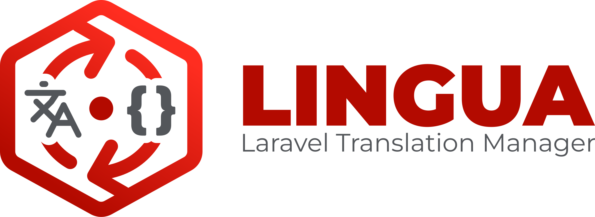
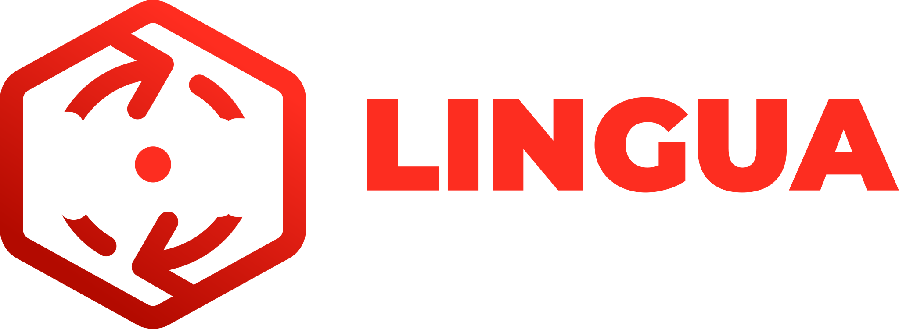

<figure style="margin: 30px auto 30px !important; max-width: 640px;">
  
  
</figure>


# What is Lingua?

Lingua is a **Laravel package** for multilingual management. It can store
every translation in your database and ships a beautiful, reactive
management UI built on [Livewire 4](https://livewire.laravel.com) and
[Flux 2](https://fluxui.dev) — or, if you prefer, keep working with plain
`lang/` files while still using the same UI.

::: tip New in 2.0
Version 2.0 removes the external `spatie/laravel-translation-loader` and
`laravel-lang/common` dependencies entirely, adds a pluggable
[storage driver](/en/guide/storage) system (database **or** file), a
[Transfer](/en/guide/quick-start) import/export workflow, and a
comprehensive [security hardening pass](/en/guide/security). It is secure
out of the box.
:::

## The problem it solves

Standard Laravel translations live in PHP and JSON files inside `lang/`.
This works well for small projects, but it creates friction as an
application grows:

- **Updating a translation requires a deployment** — even for a simple
  typo fix.
- **Non-technical team members can't edit translations** — editors need
  Git and a code review.
- **Tracking translation completeness is manual** — you have to diff files
  to find gaps.
- **Supporting many locales clutters the codebase** — dozens of files
  scattered across directories.

With the default **database driver**, Lingua stores every translation in a
single JSON column per row and provides a Livewire UI where any authorised
user can manage languages and strings in real time.

## How it works at a glance

```
┌─────────────────────────────────────────────────────────┐
│                   Laravel Application                     │
│                                                           │
│  lang/en/messages.php  ──┐                                │
│  lang/fr/messages.php    │  lingua:sync-to-database       │
│  lang/en.json            ├──────────────────────────────►│
│  lang/vendor/…           │                                │
│                         ─┘   language_lines (DB)          │
│                              ┌──────────────────────┐     │
│  LinguaManager (DB driver) ◄ │ group │ key │ text   │     │
│  app()->setLocale()          │ auth  │ … │ {"en":…} │     │
│                              └──────────────────────┘     │
│  __('auth.failed')  ─────────────────────────────────────►│
│  (DB takes precedence over files)                         │
└─────────────────────────────────────────────────────────┘
```

At runtime, Lingua's `LinguaManager` extends Laravel's own
`Illuminate\Translation\FileLoader` and is registered as the translation
loader. In **database mode** it merges file-based and database
translations with `array_replace_recursive` — **database entries always
take precedence** — so you can override any string without touching source
files. In **file mode** it behaves like the standard Laravel loader,
backed by the same UI.

## Key concepts

| Concept | Description |
|---|---|
| **Storage driver** | `database` (default) or `file` — see [Storage Drivers](/en/guide/storage) |
| **Language** | An installed locale with metadata (name, native name, direction, sort order, default flag) |
| **Translation** | A row in `language_lines` with a `group`, `key`, `type`, and a JSON `text` column holding all locale values |
| **Translation type** | `text`, `html`, or `markdown` — determines which editor is shown in the UI (database driver only) |
| **Vendor translation** | A translation that belongs to a third-party package; protected from accidental deletion |
| **Default locale** | The primary language; deleting a translation for the default locale removes the entire record |
| **Sync** | Importing local files → DB (`sync-to-database`) or exporting DB → files (`sync-to-local`) |

## Requirements

| Dependency | Version |
|---|---|
| PHP | **8.3+** |
| Laravel | **12 \| 13** |
| Livewire | **4.1+** |
| Livewire Flux | **2.12+** |

::: tip No external translation loaders
Lingua 2.0 has **no** runtime dependency on Spatie or laravel-lang. Locale
metadata (129+ locales) and the bundled translation dataset (26 locales ×
7 groups, 5902 strings, aligned to Laravel v13.14.0) ship inside the
package — no GitHub downloads at install time.
:::

## Next step

Head to the [Installation guide](/en/guide/installation) to set up Lingua
in under five minutes, or read the [Upgrade guide](/en/guide/upgrade) if
you are coming from 1.x.
